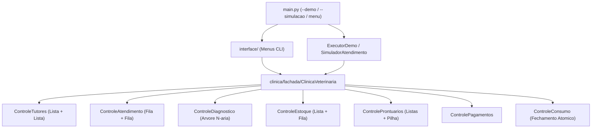

# Clínica Veterinária — Projeto de Estrutura de Dados

Sistema completo de gerenciamento de uma **Clínica Veterinária** desenvolvido em Python com orientação a objetos, separação estrita entre estruturas genéricas e regras de domínio e **estruturas de dados implementadas do zero** (`ListaEncadeada`, `FilaEncadeada`, `PilhaEncadeada` e `ArvoreNAria`), sem uso de coleções built-in (`list`, `dict`, `set`, `tuple`, `collections`) nas estruturas e regras de negócio.

> **Vídeo de Apresentação do Projeto:** [Assistir no YouTube (https://youtu.be/gHUPZ8ThLQc)](https://youtu.be/gHUPZ8ThLQc)

---

## Sumário

1. [Apresentação em Vídeo](#apresentação-em-vídeo)
2. [Visão Geral e Funcionalidades](#visão-geral-e-funcionalidades)
3. [Pré-requisitos e Instalação (`requirements.txt`)](#pré-requisitos-e-instalação-requirementstxt)
4. [Como Rodar o Projeto](#como-rodar-o-projeto)
5. [Fluxo do Código e Arquitetura](#fluxo-do-código-e-arquitetura)
6. [Por que cada Estrutura de Dados foi Usada (e por que outras NÃO foram)](#por-que-cada-estrutura-de-dados-foi-usada-e-por-que-outras-não-foram)
7. [Resumo de Complexidades (Big-O)](#resumo-de-complexidades-big-o)
8. [Testes Automatizados e Auditoria de Código](#testes-automatizados-e-auditoria-de-código)
9. [Estrutura de Diretórios](#estrutura-de-diretórios)

---

## Apresentação em Vídeo

A explicação da arquitetura, escolha das estruturas de dados, fluxo do código e execução automatizada do sistema está disponível no vídeo abaixo:

- **Link da apresentação:** https://youtu.be/gHUPZ8ThLQc

---

## Visão Geral e Funcionalidades

O sistema gerencia todo o ciclo de um atendimento veterinário ponta a ponta:

- **Controle de Tutores e Animais**: cadastro, busca por CPF do tutor, busca por nome do animal + CPF do tutor e remoção segura (bloqueia exclusão de animal em fila ou atendimento ativo), permitindo cadastrar novos animais ao longo do tempo sem limite fixo.
- **Controle de Atendimento e Consultórios**: salas limitadas, espera por ordem de chegada com prioridade absoluta para emergências (preservando ordem de chegada entre emergências) e indicação automática do próximo animal quando um consultório fica livre.
- **Diagnóstico em Árvore de Sistemas do Animal**: árvore N-ária pré-definida (0 a N filhos por nó, não binária e não de busca), com códigos nos itens finais (folhas), exibição indentada em profundidade **pré-ordem** e marcação de nós como `Alterado`.
- **Controle de Estoque de Medicamentos e Vacinas**: produtos com múltiplos lotes de datas e preços distintos, saída FIFO pelo lote mais antigo (inclusive cruzando lotes), descarte de vencidos registrado como perda (`PerdaEstoque`), ajuste manual de inventário e alerta de estoque abaixo do mínimo (`AlertaEstoque`).
- **Prontuário de Atendimento**: abertura ligada ao consultório, inclusão e remoção de medicamentos e procedimentos antes do fechamento, pilha LIFO para desfazer (undo) a última alteração, obrigatoriedade de **alta** antes de fechar e pilha de prontuários encerrados.
- **Controle de Pagamento**: `PIX`, `DINHEIRO`, `CARTAO_AVISTA` ou `CARTAO_PARCELADO` (2 a 12x), detalhando valor de medicamentos, procedimentos, total e data/hora.
- **Controle do que foi Consumido**: no fechamento atômico do prontuário, valida toda a demanda de estoque antes de debitar qualquer unidade, realiza a baixa FIFO, registra o pagamento e consolida qual tutor e qual animal consumiram quais medicamentos e lotes.

---

## Pré-requisitos e Instalação (`requirements.txt`)

- **Python 3.10 ou superior** (verifique com `python --version`).
- **Dependências externas:** este projeto foi desenvolvido **100% com Python puro** (biblioteca padrão apenas para datas, console e testes), sem bibliotecas de terceiros.

### Passo a passo para preparar o ambiente

1. **Clone o repositório e acesse a pasta do projeto:**
   ```bash
   git clone <url-do-repositorio>
   cd projeto3
   ```

2. **(Opcional) Crie e ative um ambiente virtual:**
   ```bash
   # Windows (PowerShell)
   python -m venv .venv
   .\.venv\Scripts\Activate.ps1

   # Linux / macOS
   python3 -m venv .venv
   source .venv/bin/activate
   ```

3. **Instale os requirements (arquivo mantido por padrão de projeto; não há pacotes externos obrigatórios):**
   ```bash
   pip install -r requirements.txt
   ```

---

## Como Rodar o Projeto

### 1. Modo automatizado completo (recomendado — demo + regras + 78 testes em 1 comando)
```bash
python main.py --demo
```

### 2. Menu interativo completo no terminal
```bash
python main.py
```

### 3. Simulação dos 5 passos do atendimento
```bash
python main.py --simulacao
```

### 4. Suíte detalhada de testes + auditoria AST
```bash
python testes/executor/rodar_testes.py
```

### Exemplo de saída (`python main.py --demo`)
```text
=== PASSO 1: CHEGADA E FILAS (NORMAL/EMERG) ===
Chegada 1: [NORMAL] Thor (Tutor: Ana Silva) | Queixa: Falta de apetite e vomito
Chegada 2: [EMERGENCIA] Rex (Tutor: Carlos Souza) | Queixa: Atropelamento na pata
Proximo indicado automaticamente: Rex

=== PASSO 2: CHAMADA E ABERTURA DO PRONTUARIO ===
Aberto: Prontuario #1 [ABERTO] | Animal: Rex | Tutor: Carlos Souza | Vet: Dra. Marina | Alta: NAO
Consultorio ocupado: 1

=== PASSO 3: DIAGNOSTICO (ARVORE PRE-ORDEM) ===
Undo via Pilha realizado: [DIAGNOSTICO] Estômago [DIG-01] - Saudável
- Animal - Saudável
  - Sistema digestório - Saudável
    ...
  - Pele - Saudável
    - Pelos [PEL-01] - Alterado
  - Sistema locomotor - Saudável
    - Patas - Saudável
      - Coxins [LOC-01] - Alterado

=== PASSO 4: MEDICAMENTOS E PROCEDIMENTOS ===
PERDA [AMX01] Amoxicilina (Lote #1, Val: 10/06/2025) | Qtd: 2 | Prejuizo: R$ 24.00
AMX01 (x3) e Consulta mantidos no prontuario.

=== PASSO 5: ALTA, FECHAMENTO E PAGAMENTO ===
Consumo Prontuario #1 | Tutor: Carlos Souza | Animal: Rex | Unidades: 3 | Pago: R$ 260.00
  Baixa FIFO: [AMX01] Amoxicilina (Lote #2) x2 = R$ 70.00
  Baixa FIFO: [AMX01] Amoxicilina (Lote #3) x1 = R$ 40.00
  ALERTA ESTOQUE BAIXO: [AMX01] Amoxicilina | Atual: 3 < Minimo: 5
Proximo na espera apos liberar sala: [NORMAL] Thor (Tutor: Ana Silva)

=== VERIFICACOES AUTOMATICAS DE REGRAS ===
[OK] Busca Lista+Lista (CPF+Nome): Luna (Gato, Siames, 3 anos)
[OK] Ajuste de inventario VAC01: Lote #4 | Qtd: 8
[OK] Regra validada (bloqueio): Prontuario so pode fechar apos alta do animal.

=== SUITE DE TESTES + AUDITORIA AST ===
[OK] Resultado: 78 testes | 0 falhas/erros (OK)
```

---

## Fluxo do Código e Arquitetura

O projeto separa estritamente estruturas de dados genéricas (`estruturas/`), entidades (`modelos/`), regras de negócio (`servicos/`), orquestração (`clinica/`) e interface (`interface/`), usando pacotes namespace PEP 420 (sem `__init__.py`) com **no máximo um arquivo `.py` por pasta**.



### Passo a passo do fluxo de execução

1. **Entrada (`main.py`)**: lê as flags da linha de comando (`--demo`, `--simulacao` ou menu interativo via `MenuPrincipal`) e direciona todas as operações para a fachada `ClinicaVeterinaria`.
2. **Cadastro e Chegada (`registrar_chegada_animal`)**: `ClinicaVeterinaria` consulta `ControleTutores` para garantir que tutor e animal existam, cria uma `FichaEspera` e delega a `ControleAtendimento.registrar_chegada()`, que envia o animal para `fila_emergencia` ou `fila_normal`.
3. **Chamada e Abertura (`chamar_proximo_atendimento`)**: valida o nome do veterinário antes de mexer na fila (evitando estado inconsistente), retira o próximo animal respeitando a prioridade, ocupa um `Consultorio` livre e abre um `Prontuario` via `ControleProntuarios` com sua própria árvore de diagnóstico isolada (`FabricaArvoreAnimal.criar_padrao()`).
4. **Diagnóstico e Prescrição**: o veterinário marca estruturas como `Alterado` (`ControleDiagnostico.marcar_alterado()`), adiciona ou remove medicamentos (`adicionar_medicamento_prontuario()`) e procedimentos (`adicionar_procedimento_prontuario()`) antes do fechamento, podendo desfazer a última ação pela `PilhaEncadeada` (`desfazer_ultima_acao()`).
5. **Alta e Fechamento Atômico (`fechar_atendimento` → `ControleConsumo.fechar_e_consumir`)**:
   - Exige que o animal já tenha recebido **alta** (`dar_alta`) e valida os `DadosPagamento`.
   - Descarta lotes vencidos (`PerdaEstoque`) e verifica a **demanda consolidada** de cada medicamento antes de debitar qualquer unidade (se algum remédio não tiver saldo suficiente, nada é baixado pela metade).
   - Consome o estoque pelo lote mais antigo (FIFO), emite `AlertaEstoque` se ficar abaixo do mínimo, calcula o valor real pelos lotes consumidos, registra `Pagamento` e `RegistroConsumo`, move o prontuário para a pilha de fechados e libera o consultório indicando automaticamente o próximo animal da espera.

---

## Por que cada Estrutura de Dados foi Usada (e por que outras NÃO foram)

### 1. Tutores e seus Animais — `Lista + Lista`

- **Classes e métodos envolvidos**: `ListaEncadeada` (`adicionar`, `buscar`, `remover_por_criterio`), `Tutor` (`adicionar_animal`, `buscar_animal`, `remover_animal`) e `ControleTutores` (`cadastrar_tutor`, `buscar_tutor_por_cpf`, `cadastrar_animal`, `buscar_animal`, `remover_animal`, `remover_tutor`).
- **Por que usamos esta combinação**:
  - Modela diretamente a relação 1:N (`Tutor -> 1..N Animais`), permitindo cadastrar novos animais ao longo do tempo sem limite fixo, localizar rapidamente o tutor por CPF e buscar ou remover qualquer animal dentro apenas da lista daquele tutor.
- **Por que outras estruturas NÃO resolvem**:
  - **Fila ou Pilha**: não servem porque restringem acesso às pontas (FIFO/LIFO), enquanto aqui precisamos buscar e remover qualquer CPF ou animal em posição arbitrária no meio da estrutura.
  - **Árvore**: acrescentaria complexidade desnecessária para uma relação simples de dois níveis (`Tutor -> Animais`).
  - **Uma única Lista achatada**: obrigaria a duplicar dados do tutor (nome, CPF, telefone) em cada animal — gerando risco de inconsistência em edições/remoções — e forçaria varrer todos os animais da clínica inteira em vez de apenas os do tutor encontrado.

---

### 2. Atendimento com Prioridade para Emergências — `Fila + Fila`

- **Classes e métodos envolvidos**: `FilaEncadeada` (`enfileirar`, `desenfileirar`, `espiar`, `esta_vazia`) e `ControleAtendimento` (`registrar_chegada`, `indicar_proximo`, `chamar_proximo`, `_desenfileirar_proximo`, `liberar_consultorio`).
- **Por que usamos esta combinação**:
  - `fila_emergencia` e `fila_normal` garantem simultaneamente prioridade absoluta para emergências e justiça por ordem de chegada (FIFO) dentro de cada fila, com entrada e saída imediatas nas pontas.
- **Por que outras estruturas NÃO resolvem**:
  - **Pilha**: inverte a ordem de chegada (LIFO), atendendo quem acabou de chegar antes de quem espera há mais tempo — totalmente inadequado para uma fila de clínica.
  - **Uma única Fila**: prenderia animais em estado crítico atrás de consultas normais, violando a regra de prioridade clínica.
  - **Uma única Lista**: obrigaria a percorrer ou reorganizar elementos a cada chamada/inserção para separar emergências de normais, correndo risco de perder a simplicidade e a ordem FIFO.

---

### 3. Diagnóstico na Árvore de Sistemas do Animal — `Árvore N-ária + Lista Encadeada`

- **Classes e métodos envolvidos**: `NoArvore` (`adicionar_filho`, `eh_folha`, `quantidade_filhos`), `ArvoreNAria` (`percorrer_pre_ordem`, `buscar_no`, `filtrar_dados`), `FabricaArvoreAnimal.criar_padrao()` e `ControleDiagnostico` (`gerar_arvore_indentada`, `marcar_alterado`, `listar_alterados`).
- **Por que usamos esta combinação**:
  - A anatomia animal é hierárquica com quantidade livre de ramificações (`Animal` → 4 sistemas → 3 ou mais órgãos → subestruturas como `Patas -> Coxins / Dedos`). Cada nó guarda seus filhos em uma `ListaEncadeada`, suportando de 0 a N filhos e permitindo exibição indentada natural em **pré-ordem**.
- **Por que outras estruturas NÃO resolvem**:
  - **Lista, Fila ou Pilha**: estruturas lineares não expressam relação pai-filho nem profundidade hierárquica sem gambiarras manuais de níveis/caminhos.
  - **Árvore Binária ou Árvore Binária de Busca (BST)**: limitam cada nó a no máximo 2 filhos e ordenam por chave, distorcendo a anatomia real onde um único sistema possui 3 ou mais órgãos e a relação é de composição, não de ordenação.

---

### 4. Estoque com Vários Lotes por Medicamento — `Lista + Fila`

- **Classes e métodos envolvidos**: `ListaEncadeada` (`adicionar`, `buscar`), `FilaEncadeada` (`enfileirar`, `espiar`, `desenfileirar`), `ProdutoEstoque` (`adicionar_lote`, `quantidade_valida`) e `ControleEstoque` (`adicionar_lote`, `baixar_estoque`, `_consumir_fila_fifo`, `_consumir_lote_frente`, `descartar_vencidos`, `ajustar_quantidade`).
- **Por que usamos esta combinação**:
  - A `ListaEncadeada` localiza qualquer produto pelo código, enquanto a `FilaEncadeada` interna de cada produto impõe rigorosamente a saída **FIFO** pelo lote mais antigo, atravessando múltiplos lotes com preços diferentes e descartando vencidos antes do consumo.
- **Por que outras estruturas NÃO resolvem**:
  - **Pilha de lotes**: consumiria sempre o lote mais recente (LIFO), deixando os lotes mais antigos parados no fundo até vencerem e gerarem prejuízo.
  - **Uma única Fila global**: misturaria lotes de medicamentos diferentes na mesma fila, obrigando a desenfileirar e reenfileirar outros produtos só para alcançar o lote de um medicamento específico.
  - **Uma única Lista achatada de lotes**: obrigaria a varrer todos os lotes de todos os produtos repetidamente para descobrir qual é o lote mais antigo de determinado código.

---

### 5. Prontuário com Histórico Reversível e Encerrados — `Listas + Pilha LIFO`

- **Classes e métodos envolvidos**: `PilhaEncadeada` (`empilhar`, `desempilhar`, `topo`), `Prontuario` (`adicionar_medicamento`, `remover_medicamento`, `adicionar_procedimento`, `remover_procedimento`, `desfazer_ultima_acao`) e `ControleProntuarios` (`abrir_prontuario`, `desfazer_ultima_acao`, `encerrar_prontuario`).
- **Por que usamos esta combinação**:
  - Medicamentos e procedimentos ficam em `ListaEncadeada` para permitir remover qualquer item específico antes do fechamento (ex.: um exame que o tutor não autorizou). Já a `PilhaEncadeada` (`historico_acoes`) implementa o **desfazer (undo)** revertendo a ação mais recente, e `prontuarios_fechados` mantém o último prontuário encerrado no topo.
- **Por que outras estruturas NÃO resolvem**:
  - **Usar apenas Pilha**: impediria remover um procedimento no meio do prontuário sem ter que desempilhar todos os demais.
  - **Usar apenas Fila**: desfazer uma ação errada exigiria reverter a *última* alteração (LIFO), não a primeira (FIFO).
  - **Usar apenas Listas**: não modela nativamente a semântica de desfazer imediato no topo da pilha.

---

## Resumo de Complexidades (Big-O)

| Operação | Estrutura(s) | Tempo | Espaço Auxiliar |
| :--- | :--- | :---: | :---: |
| Inserir no início/fim | `ListaEncadeada` | `O(1)` | `O(1)` |
| Buscar / remover por critério | `ListaEncadeada` | `O(n)` | `O(1)` |
| Enfileirar / Desenfileirar / Espiar | `FilaEncadeada` | `O(1)` | `O(1)` |
| Empilhar / Desempilhar / Topo | `PilhaEncadeada` | `O(1)` | `O(1)` |
| Chegada e chamada com prioridade | `Fila + Fila` | `O(1)` | `O(1)` |
| Buscar animal por CPF + nome | `Lista + Lista` | `O(T + A_t)` | `O(1)` |
| Baixa FIFO de estoque por lote | `Lista + Fila` | `O(P + K)` | `O(K)` |
| Travessia pré-ordem / busca | `ArvoreNAria` | `O(V)` | `O(H)` |

*Legenda: `T` = total de tutores; `A_t` = animais do tutor; `P` = total de produtos; `K` = lotes consumidos na baixa; `V` = nós da árvore; `H` = altura da árvore.*

---

## Testes Automatizados e Auditoria de Código

A suíte possui **78 testes automatizados** (`python testes/executor/rodar_testes.py` ou via `python main.py --demo`):

- **Estruturas próprias (`testes/estruturas/`)**: validação de ponteiros, esvaziamento/reinserção, pré-ordem e estresse com **500 elementos**.
- **Serviços (`testes/servicos/`)**: CPF com máscaras distintas, prioridade `Fila + Fila`, perdas por vencimento, baixa FIFO multi-lote, atomicidade de fechamento, undo LIFO e validações de pagamento.
- **Integração e CLI (`testes/integracao/`)**: disputa concorrente de estoque entre dois prontuários abertos, bloqueio de remoção de paciente ativo, `main.py --simulacao`, `main.py --demo` e menus interativos.
- **Auditoria AST (`testes/auditoria/test_auditoria_codigo.py`)**: valida `main.py` na raiz, máximo de **1 `.py` por pasta** (sem `__init__.py`), funções com até **10 linhas úteis**, docstrings estilo Google em 100% do código, largura máxima de **79 caracteres** e **zero coleções built-in** em produção.

---

## Estrutura de Diretórios

```text
projeto3/
├── .gitignore
├── main.py
├── README.md
├── requirements.txt
├── estruturas/
│   ├── no/no.py
│   ├── iterador/iterador_encadeado.py
│   ├── lista/lista_encadeada.py
│   ├── fila/fila_encadeada.py
│   ├── pilha/pilha_encadeada.py
│   └── arvore/
│       ├── no_arvore/no_arvore.py
│       └── arvore_n_aria/arvore_n_aria.py
├── utilitarios/
│   ├── data_hora/validador_data.py
│   └── validacao/validador_entrada.py
├── modelos/
│   ├── animal/animal.py
│   ├── tutor/tutor.py
│   ├── atendimento/
│   │   ├── ficha_espera/ficha_espera.py
│   │   └── consultorio/consultorio.py
│   ├── diagnostico/
│   │   ├── item_diagnostico/item_diagnostico.py
│   │   └── fabrica_arvore/fabrica_arvore_animal.py
│   ├── estoque/
│   │   ├── dados_lote/dados_lote.py
│   │   ├── lote/lote.py
│   │   ├── produto_estoque/produto_estoque.py
│   │   ├── perda_estoque/perda_estoque.py
│   │   └── alerta_estoque/alerta_estoque.py
│   ├── prontuario/
│   │   ├── item_medicamento/item_medicamento.py
│   │   ├── procedimento/procedimento.py
│   │   ├── acao_historico/acao_historico.py
│   │   └── prontuario/prontuario.py
│   ├── pagamento/
│   │   ├── dados_pagamento/dados_pagamento.py
│   │   └── pagamento/pagamento.py
│   └── consumo/
│       ├── item_consumido/item_consumido.py
│       └── registro_consumo/registro_consumo.py
├── servicos/
│   ├── tutores/controle_tutores.py
│   ├── atendimento/controle_atendimento.py
│   ├── diagnostico/controle_diagnostico.py
│   ├── estoque/controle_estoque.py
│   ├── prontuario/controle_prontuarios.py
│   ├── pagamento/controle_pagamentos.py
│   └── consumo/controle_consumo.py
├── clinica/
│   ├── fachada/clinica_veterinaria.py
│   ├── simulacao/simulador_atendimento.py
│   └── demonstracao/executor_demo.py
├── interface/
│   ├── entrada/leitor_console.py
│   ├── exibicao/formatador_saida.py
│   └── menus/
│       ├── tutores/menu_tutores.py
│       ├── atendimento/menu_atendimento.py
│       ├── estoque/menu_estoque.py
│       ├── prontuario/menu_prontuario.py
│       └── principal/menu_principal.py
└── testes/
    ├── executor/rodar_testes.py
    ├── auditoria/test_auditoria_codigo.py
    ├── estruturas/{lista,fila,pilha,arvore}/test_*.py
    ├── servicos/{tutores,atendimento,diagnostico,estoque,prontuario,pagamento,consumo}/test_*.py
    └── integracao/{fluxo_completo,interface_cli}/test_*.py
```
